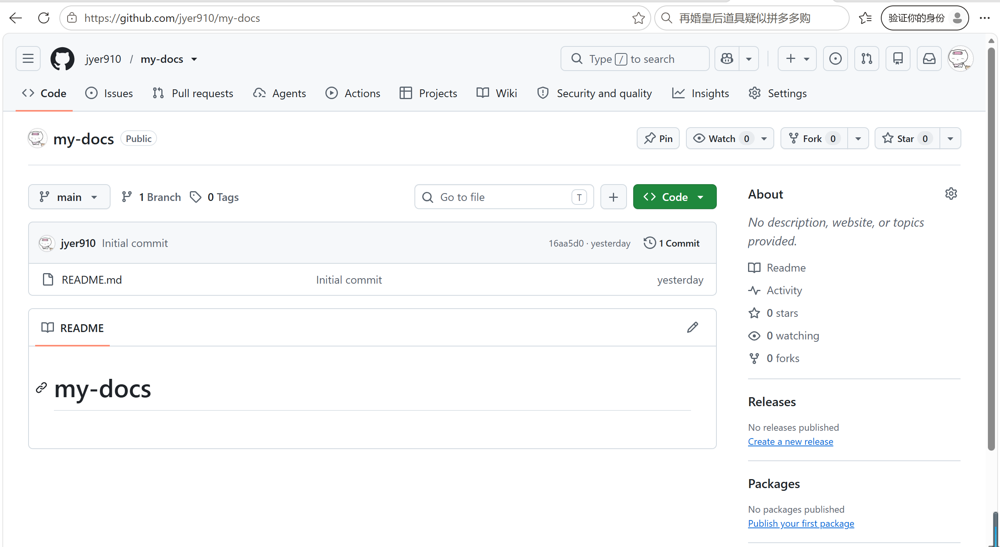
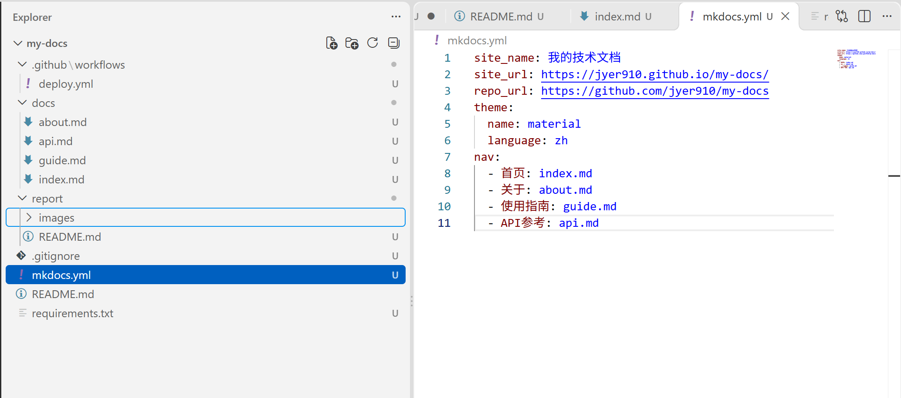
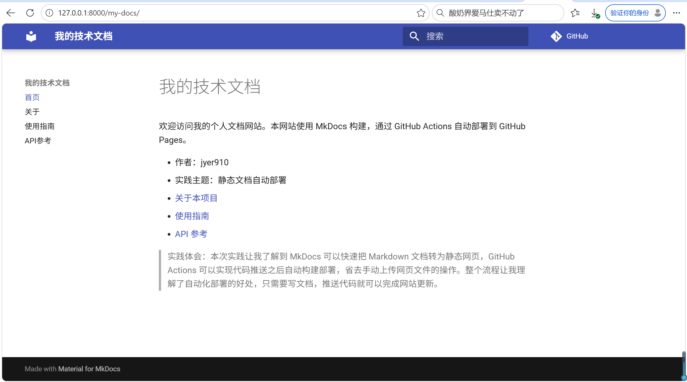
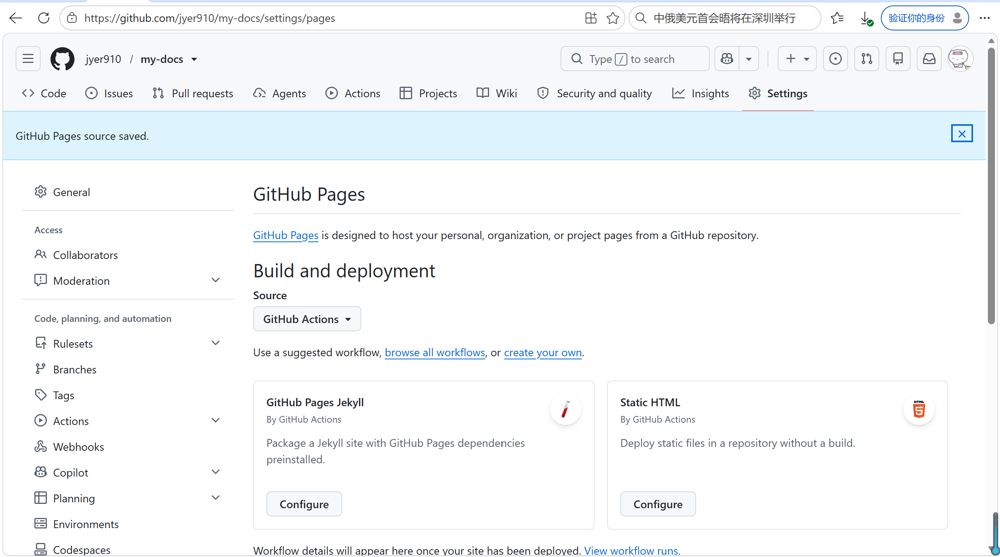
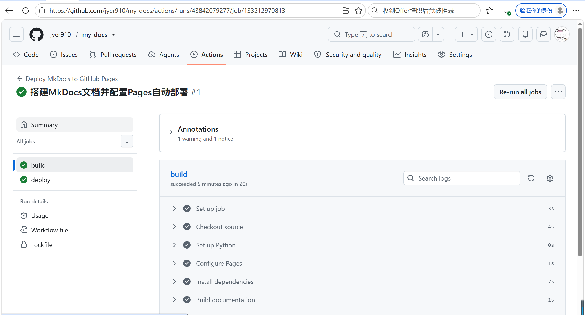
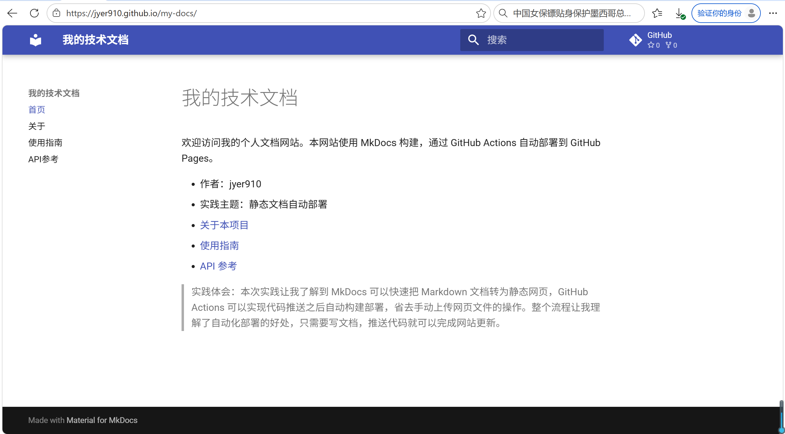
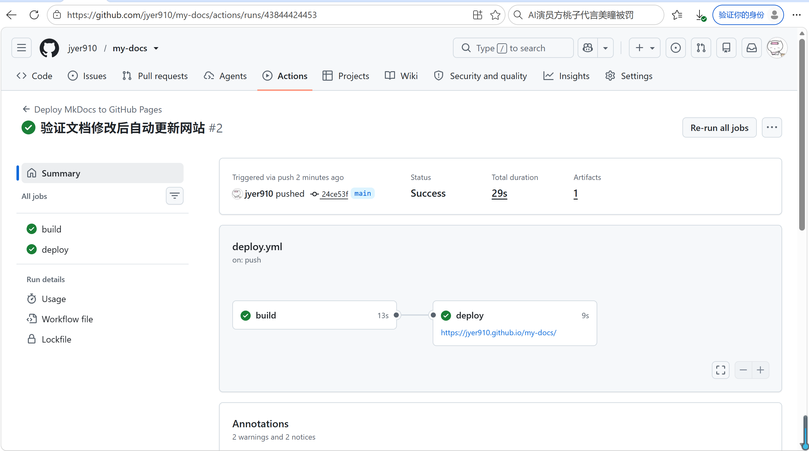
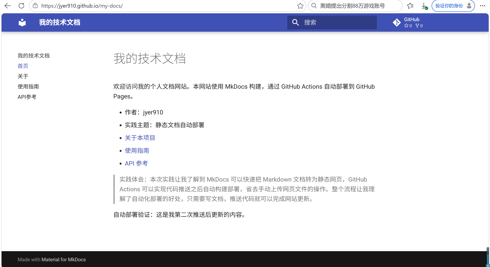

# 实践项目2：个人实验报告
## 1. 基本信息
- GitHub 登录名：jyer910
- 个人仓库地址：https://github.com/jyer910/my-docs
- 最终网站地址：https://jyer910.github.io/my-docs/

## 2. 实践过程与关键截图
### 2.1 仓库创建
操作：登录GitHub，新建公开仓库my‑docs，勾选README，确认默认分支为main，复制HTTPS地址，本地git clone克隆到电脑，配置git用户名邮箱。

结果：得到本地与远程同步的公开仓库，仓库所有者、仓库名、Public标识可见。

### 2.2 项目结构与 MkDocs 配置
操作：按照目录结构创建.github/workflows/deploy.yml、docs下4个md文档、mkdocs.yml、requirements.txt、.gitignore，编写导航nav配置，YAML使用空格缩进，禁止Tab。

说明：
- docs/：存放所有Markdown源文档，是网站的源码；
- nav：mkdocs配置项，定义网站导航菜单；
- site/：mkdocs.build命令后自动生成的静态网站。
### 2.3 本地构建或预览
操作：创建Python虚拟环境，激活环境，安装依赖，执行 python -m mkdocs build --strict 构建；执行 python -m mkdocs serve本地预览。

结果：本地服务正常启动，访问`http://127.0.0.1:8000/my-docs/`,并依次检查了首页、关于、使用指南、API参考四页，校验导航跳转、表格、代码块、页面内链接，均没有错误。

### 2.4 Pages 设置
操作：进入仓库 Settings → Pages → Build and deployment，将 Source 选项修改为 GitHub Actions，保存；再进入 Settings → Actions → General，确认仓库允许执行Actions工作流。本方案在工作流内部配置部署权限，不修改仓库全局默认权限，不开启“允许Actions创建并批准PR”选项。

结果：Pages发布来源设置为GitHub Actions，后续流水线构建产物可以直接发布到GitHub Pages。

### 2.5 Actions 首次构建和部署
操作：git add、git diff --staged检查暂存，commit提交配置，push推送到main分支；进入仓库Actions页面查看流水线。

结果：工作流自动触发，build、deploy两个任务全部绿色，首次部署成功。

补充说明（个人理解）：
- push：当代码推送到 main 分支，并且修改了指定文件时，自动触发流水线；如果只改动 README、实验报告这类不在范围内的文件，不会启动工作流。
- workflow_dispatch：开启手动触发功能，可以直接在仓库的 Actions 页面点击按钮运行流水线，方便调试、重新部署。
- build：构建任务，会拉取项目源码，配置 Python 环境，安装项目依赖，执行mkdocs构建，最后把生成的site静态文件上传保存。
- needs: build：设置任务依赖关系，只有build构建任务执行成功之后，才会继续执行后面的部署步骤。
- pages: write、id-token: write：给当前工作流分配权限，让它拥有写入GitHub Pages、完成部署所需要的权限。
- github-pages：是GitHub Pages专属部署环境，用来承载、管理本次构建出来的网站资源。

### 2.6 网站访问与四页导航检查
操作：访问GitHub Pages网站地址，逐个打开首页、关于、使用指南、API参考页面。

结果：全部页面正常加载，导航菜单全部显示，页面之间跳转正常，不存在404。

### 2.7 第二次推送与自动更新验证
- 对应提交链接：https://github.com/jyer910/my-docs/commit/24ce53fa1b5fd2760235bb33a0523ea9e1390abc
- 对应Actions运行链接：https://github.com/jyer910/my-docs/actions/runs/43844424453

操作：修改docs/index.md，增加验证文字自动部署验证：这是我第二次推送后更新的内容。；执行git add、commit、push；不手动点击重新运行工作流，依靠push自动触发流水线。

结果：push自动生成一条新的Actions运行记录，build与deploy全部成功；浏览器Ctrl+F5强制刷新网站，首页出现新增验证文字，证明自动更新生效。

## 3. 问题与解决
记录实际现象、关键日志、原因和解决操作。

### 问题1：使用Personal Access Token推送，上传deploy.yml时报错，提示没有workflow scope权限。

现象：推送被拒绝，提示refusing to allow a Personal Access Token to create or update workflow。

原因：生成classic PAT时仅勾选repo权限，缺少workflow权限，无法修改workflows下yml文件。

解决：重新生成Personal Access Token，同时勾选repo和workflow权限，使用新token完成推送。

### 问题2：Actions流水线已经执行成功，网页看不到修改后的新内容。

现象：Actions全部绿色，但网页依旧显示旧内容。

原因：浏览器缓存、GitHub Pages分发延迟。

解决：使用`Ctrl+F5`强制刷新，或打开浏览器无痕窗口访问，等待片刻。

## 4. 原理理解
### 1. docs/ 和 site/ 各保存什么？为什么不用手工修改 site/?

'docs/'存放Markdown源码文档，是我们手写编辑的源文件；'site/'是Mkdocs构建生成的静态HTML网站产物。site/是程序自动生成，修改会在下次构建被覆盖，所以不用手动修改。

### 2. 本次工作流在什么情况下自动运行？

当向main分支推送代码，且修改文件属于：docs/**、mkdocs.yml、requirements.txt、.github/workflows/deploy.yml时，会自动触发；另外支持手动workflow_dispatch触发。

### 3. build 与 deploy 两个任务有什么区别？

- build：检出代码、配置Python环境、安装依赖、执行mkdocs构建，把site产物上传为构件；
- deploy：依赖build任务完成之后才执行，把build产出的site构件正式发布到GitHub Pages。总之，build做构建，deploy做发布。

### 4. 只修改 report/README.md 会触发部署吗？为什么？

不会触发。工作流'on.push.paths'配置限定了只有docs、mkdocs.yml、requirements.txt、deploy.yml发生变更才触发；修改report/README.md不在触发路径列表，不会运行流水线。

### 5. 本次方案为何无需创建gh-pages分支？

本次实验使用GitHub官方Pages Actions方案，构建产物以artifact构件形式传递，直接发布到Pages服务，不需要维护独立gh‑pages分支存放静态网页。